<div align="center">

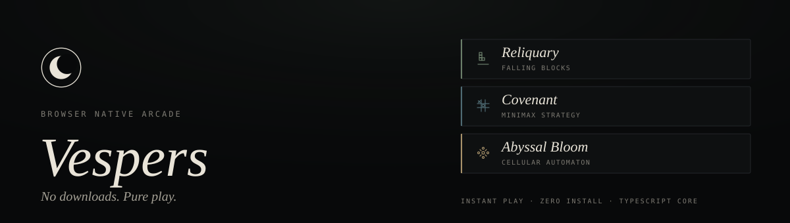

<br/>

<!-- identity -->
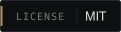
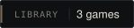
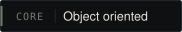
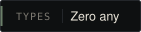

<br/>

<!-- stack -->
<a href="https://react.dev">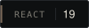</a>
<a href="https://www.typescriptlang.org">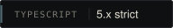</a>
<a href="https://vite.dev">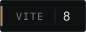</a>
<a href="https://reactrouter.com">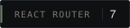</a>
<a href="https://oxc.rs">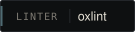</a>

<br/>

<!-- platform -->
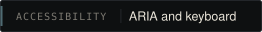
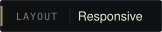
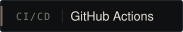
<a href="#deployment">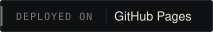</a>
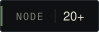

<br/><br/>

*A curated library of instant play, browser native games, engineered with a strict object oriented TypeScript core and a React 19 presentation layer.*

<br/>

[Overview](#overview) · [Features](#features) · [Architecture](#architecture) · [Games](#games) · [Controls](#controls-reference) · [Tech stack](#tech-stack) · [Getting started](#getting-started) · [Deployment](#deployment) · [Migration](#migration-notes) · [License](#license)

</div>

---

<a id="overview"></a>
##  Overview

**Vespers** is a full migration of a static, vanilla JavaScript arcade site into a production grade, type safe, component driven single page application. Every game runs on its own object oriented engine class, completely decoupled from the rendering layer, so the same simulation code could power a canvas view, a DOM view, or a future native client without modification.

The project ships with three playable titles that share one engine contract and one visual language:

- **Reliquary** is a falling block puzzle with a hold slot, next piece preview and a dynamic level speed curve.
- **Covenant** is a strategy game against a minimax AI with three difficulty tiers.
- **Abyssal Bloom** is a cellular automaton sandbox with live speed control and one click seed patterns.

No downloads, no accounts, no install step. Open a URL and play.

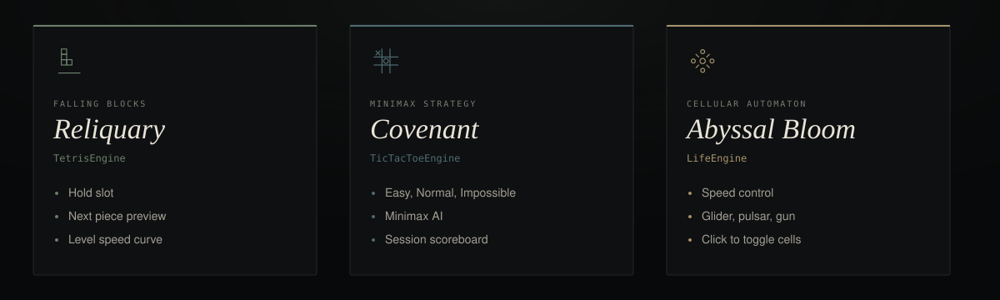

---

<a id="features"></a>
##  Features

<table>
<tr>
<td width="50%" valign="top">

 **Object oriented core**
- Every game is a class hierarchy with clear encapsulation
- Private mutation methods, immutable state snapshots to the UI
- Shared `GameEngine<TState>` base: `start`, `reset`, `stop`, `destroy`
- React subscribes through a small publish and subscribe bridge

</td>
<td width="50%" valign="top">

 **Fully typed**
- Zero `any` in application code
- Strict TypeScript compiler options
- Shared discriminated types for board state, engine state and difficulty levels

</td>
</tr>
<tr>
<td width="50%" valign="top">

 **Reliquary**
- Hold slot and next piece preview
- Level based speed ramp
- Full keyboard support
- Touch controls appear automatically on small viewports

</td>
<td width="50%" valign="top">

 **Covenant**
- Minimax AI, from forgiving to unbeatable
- Easy, Normal and Impossible tiers, switchable any time
- Live session scoreboard

</td>
</tr>
<tr>
<td width="50%" valign="top">

 **Abyssal Bloom**
- Standard Conway ruleset
- Adjustable simulation speed
- Stamp a glider, pulsar or glider gun
- Click any cell to toggle it

</td>
<td width="50%" valign="top">

 **Platform**
- Semantic landmarks, skip links, ARIA labelled board cells
- Layouts reflow down to mobile widths
- Browser Router with clean, shareable game URLs
- Push to `main` to type check, lint, build and deploy

</td>
</tr>
</table>

---

<a id="architecture"></a>
##  Architecture


The application is organised into four clean layers: presentation, engine, data and delivery. React never touches game state directly. Instead it subscribes to an engine instance through a small publish and subscribe bridge defined on the shared `GameEngine<TState>` abstract base class.

### Engine class hierarchy


Every game engine extends the same abstract base, guaranteeing a consistent lifecycle (`start`, `reset`, `stop`, `destroy`) and a consistent subscription model across three otherwise unrelated simulations.

```
src/
├── engine/                  Framework agnostic OOP game engines
│   ├── GameEngine.ts        Abstract base class (lifecycle + pub/sub)
│   ├── SoundManager.ts      WebAudio backed sound effect utility
│   ├── TetrisEngine.ts      Reliquary simulation
│   ├── TicTacToeEngine.ts   Covenant simulation + minimax AI
│   └── LifeEngine.ts        Abyssal Bloom (Conway's Game of Life) simulation
├── components/
│   ├── layout/              Navbar, Footer
│   ├── home/                Hero, Carousel, GameCard, Mission
│   └── games/               Shared game page chrome
├── pages/                   Route level views, one per screen
├── data/                    Static content (game metadata)
└── styles/                  Design tokens and shared CSS
```

---

<a id="games"></a>
##  Games

| | Game | Genre | Engine class | Signature upgrade |
|---|---|---|---|---|
|  | **Reliquary** | Falling block puzzle | `TetrisEngine` | Hold slot, next piece preview, dynamic level speed curve |
|  | **Covenant** | Strategy | `TicTacToeEngine` | Minimax AI with Easy, Normal and Impossible difficulty tiers |
|  | **Abyssal Bloom** | Cellular automaton | `LifeEngine` | Live speed control and one click seed patterns (glider, pulsar, glider gun) |

---

<a id="controls-reference"></a>
##  Controls reference

<table>
<tr><th>Reliquary</th><th>Covenant</th><th>Abyssal Bloom</th></tr>
<tr valign="top">
<td>

`←` `→` Move
`↑` Rotate
`↓` Soft drop
`Space` Hard drop
`C` Hold piece
`P` Pause

</td>
<td>

Click a cell to play as **O**
Switch difficulty at any time
Session scoreboard tracked live

</td>
<td>

Click any cell to toggle it
Drag the slider to change speed
Stamp a glider, pulsar or glider gun

</td>
</tr>
</table>

---

<a id="tech-stack"></a>
##  Tech stack

| Layer | Technology |
|---|---|
| UI framework | React 19 (function components, hooks) |
| Language | TypeScript 5, strict mode |
| Build tool | Vite 8 |
| Routing | React Router 7 (Browser Router) |
| Linting | oxlint |
| CI/CD | GitHub Actions to GitHub Pages |

---

<a id="getting-started"></a>
##  Getting started

**Prerequisites:** Node.js 20 or later, and npm 10 or later.

```bash
git clone https://github.com/hassanireza/vespers.git
cd vespers
npm install
npm run dev
```

Open [http://localhost:5173](http://localhost:5173). The dev server hot-reloads on every save.

```bash
npx tsc -b         # type check
npm run lint       # oxlint
npm run build      # production bundle into dist/
npm run preview    # serve the production build locally
```

---

<a id="deployment"></a>
##  Deployment

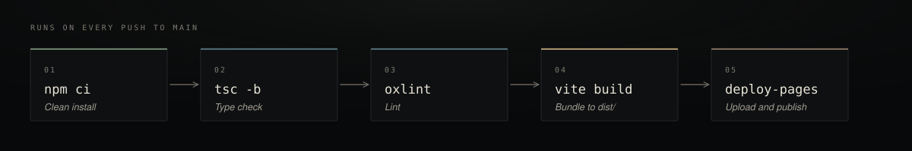

This repository deploys itself. `.github/workflows/deploy.yml` runs on every push to `main`:

1. Installs dependencies with `npm ci`
2. Type checks the entire codebase with `tsc -b`
3. Lints the codebase with `oxlint`
4. Builds the production bundle with Vite
5. Uploads `dist/` as a Pages artifact and deploys it

**To enable it on your own fork:**

1. Push this repository to GitHub
2. Open **Settings, Pages** and set **Source** to **GitHub Actions**
3. Push to `main`. The site goes live at `https://hassanireza.github.io/vespers/` within a couple of minutes

The Vite config uses an absolute `base: "/vespers/"`, and the app uses a Browser Router with a matching `basename`, so clean URLs like `/vespers/games/covenant` work directly. A `public/404.html` fallback handles GitHub Pages' static hosting so deep links and page refreshes resolve correctly.

---

##  Migration notes

This codebase replaces a vanilla HTML, CSS and JavaScript implementation. Every game's rules and scoring behaviour were preserved and then extended:

- **Reliquary** kept its original scoring curve and piece set, and gained a hold slot, a next piece preview and a smoother level based speed ramp.
- **Covenant** kept its original minimax algorithm and extended it with three selectable difficulty tiers and a running scoreboard.
- **Abyssal Bloom** kept the standard Conway ruleset and added an adjustable simulation speed and a library of classic seed patterns.

All DOM manipulation was replaced with declarative React rendering driven by an explicit engine state snapshot, and all game logic was isolated into plain TypeScript classes with no framework dependencies, making the engines independently testable and reusable.

---

##  Accessibility and platform

- Semantic landmarks and skip links on every page
- ARIA labelling on every interactive board cell
- Full keyboard support in Reliquary
- Touch controls appear automatically for Reliquary on small viewports
- Every layout reflows gracefully down to mobile widths

---

## 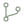 Contributing

1. Fork the repository
2. Create a branch: `git checkout -b feat/my-change`
3. Make your changes
4. Run `npx tsc -b` and `npm run lint`, and make sure both pass
5. Open a pull request against `main`

Guidelines:

- **Engines stay framework agnostic.** Nothing under `src/engine/` imports React.
- **State flows one way.** The UI renders immutable snapshots and never mutates engine state directly.
- **Types stay strict.** No `any` in application code.

---

<a id="license"></a>
##  License

Distributed under the MIT License. See [`LICENSE`](./LICENSE) for details.

<div align="center">

<br/>


<br/>

<sub>Built with care for players who just want to hit play.</sub>

</div>
