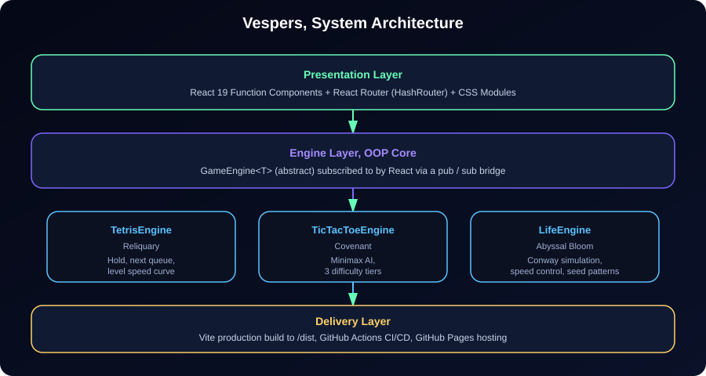
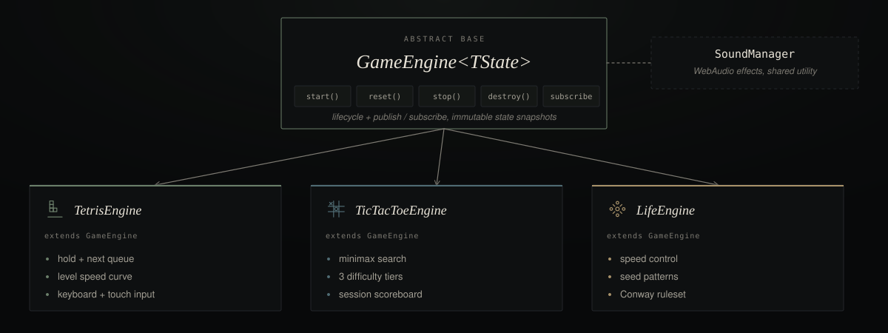

<div align="center">


# Vespers

**No downloads. Pure play.**
A curated library of instant play, browser native games, engineered with a strict
object oriented TypeScript core and a React 19 presentation layer.

[](#deployment)
[](#tech-stack)
[](#tech-stack)
[](#tech-stack)

</div>

---

## Overview

Vespers is a full migration of a static, vanilla JavaScript arcade
site into a production grade, type safe, component driven single page
application. Every game runs on its own object oriented engine class,
completely decoupled from the rendering layer, so the same simulation code
could power a canvas view, a DOM view, or a future native client without
modification.

The project ships with three playable titles:

| Game | Genre | Engine Class | Signature Upgrade |
|---|---|---|---|
| **Reliquary** | Falling block puzzle | `TetrisEngine` | Hold slot, next piece preview, dynamic level speed curve |
| **Covenant** | Strategy | `TicTacToeEngine` | Minimax AI with Easy, Normal, and Impossible difficulty tiers |
| **Abyssal Bloom** | Cellular automaton | `LifeEngine` | Live speed control and one click seed patterns (glider, pulsar, glider gun) |

---

## Architecture

The application is organised into four clean layers: presentation, engine,
data, and delivery. React never touches game state directly; instead it
subscribes to an engine instance through a small publish and subscribe
bridge defined on the shared `GameEngine<TState>` abstract base class.

<div align="center">
  
</div>

### Engine class hierarchy

Every game engine extends the same abstract base, guaranteeing a consistent
lifecycle (`start`, `reset`, `stop`, `destroy`) and a consistent subscription
model across three otherwise unrelated simulations.

<div align="center">
  
</div>

```
src/
├── engine/                  Framework agnostic OOP game engines
│   ├── GameEngine.ts        Abstract base class (lifecycle + pub/sub)
│   ├── SoundManager.ts      WebAudio backed sound effect utility
│   ├── TetrisEngine.ts      Reliquary simulation
│   ├── TicTacToeEngine.ts   Covenant simulation + minimax AI
│   └── LifeEngine.ts        Abyssal Bloom (Conway's Game of Life) simulation
├── components/
│   ├── layout/               Navbar, Footer
│   ├── home/                 Hero, Carousel, GameCard, Mission
│   └── games/                Shared game page chrome
├── pages/                    Route level views, one per screen
├── data/                     Static content (game metadata)
└── styles/                   Design tokens and shared CSS
```

---

## Feature Highlights

- **Object oriented core.** Every game is modelled as a class hierarchy with
  clear encapsulation, private mutation methods, and immutable state
  snapshots handed to the UI.
- **Fully typed.** Zero `any` in application code, strict TypeScript
  compiler options, and shared discriminated types for board state, engine
  state, and difficulty levels.
- **Hold and preview queue** in Reliquary, a mechanic entirely new to this
  migration that was not present in the original implementation.
- **Three tier AI difficulty** in Covenant, from a forgiving opponent for
  newcomers to a mathematically unbeatable minimax player.
- **Simulation speed control and pattern presets** in Abyssal Bloom, including
  the classic glider gun.
- **Client side routing** with `react-router-dom`, using a browser router so
  every game has a clean, shareable URL, backed by a GitHub Pages fallback
  page for deep links.
- **Accessible by default.** Semantic landmarks, skip links, ARIA labelling
  on every interactive board cell, and full keyboard support in Reliquary.
- **Responsive across devices.** Touch controls automatically appear for
  Reliquary on small viewports, and every layout reflows gracefully down
  to mobile widths.
- **Continuous delivery.** Every push to `main` is type checked, linted,
  built, and deployed to GitHub Pages automatically.

---

## Tech Stack

<div align="center">

| Layer | Technology |
|---|---|
| UI Framework | React 19 (function components, hooks) |
| Language | TypeScript 5, strict mode |
| Build Tool | Vite 8 |
| Routing | React Router 7 (Browser Router) |
| Linting | oxlint |
| CI/CD | GitHub Actions to GitHub Pages |

</div>

---

## Getting Started

### Prerequisites

- Node.js 20 or later
- npm 10 or later

### Installation

```bash
git clone https://github.com/hassanireza/vespers.git
cd vespers
npm install
```

### Local development

```bash
npm run dev
```

The dev server starts on `http://localhost:5173` with hot module reloading.

### Type checking and linting

```bash
npx tsc -b
npm run lint
```

### Production build

```bash
npm run build
npm run preview
```

The optimised, production ready bundle is emitted to `dist/`.

---

## Deployment

This repository deploys itself. The workflow at
`.github/workflows/deploy.yml` runs on every push to `main`:

1. Installs dependencies with `npm ci`.
2. Type checks the entire codebase with `tsc -b`.
3. Lints the codebase with `oxlint`.
4. Builds the production bundle with Vite.
5. Uploads the `dist/` directory as a Pages artifact and deploys it.

To enable it on your own fork:

1. Push this repository to GitHub.
2. Open **Settings → Pages** and set **Source** to **GitHub Actions**.
3. Push to `main`. The site will be live at
   `https://hassanireza.github.io/vespers/` within a couple
   of minutes.

The Vite config uses an absolute `base: "/vespers/"`, and the app uses a
`Browser Router` with a matching `basename`, so clean URLs like
`/vespers/games/covenant` work directly. A `public/404.html` fallback
handles GitHub Pages' static hosting so deep links and page refreshes
resolve correctly.

---

## Controls Reference

<table>
<tr><th>Reliquary</th><th>Covenant</th><th>Abyssal Bloom</th></tr>
<tr valign="top">
<td>

`←` `→` Move
`↑` Rotate
`↓` Soft drop
`Space` Hard drop
`C` Hold piece
`P` Pause

</td>
<td>

Click a cell to play as **O**
Switch difficulty at any time
Session scoreboard tracked live

</td>
<td>

Click any cell to toggle it
Drag the slider to change speed
Stamp a glider, pulsar, or glider gun

</td>
</tr>
</table>

---

## Migration Notes

This codebase replaces a vanilla HTML, CSS, and JavaScript implementation.
Every game's rules and scoring behaviour were preserved and then extended:

- **Reliquary** kept its original scoring curve and piece set, and gained
  a hold slot, a next piece preview, and a smoother level based speed ramp.
- **Covenant** kept its original minimax algorithm and extended it with
  three selectable difficulty tiers and a running scoreboard.
- **Abyssal Bloom** kept the standard Conway ruleset and added an adjustable
  simulation speed and a library of classic seed patterns.

All DOM manipulation was replaced with declarative React rendering driven
by an explicit engine state snapshot, and all game logic was isolated into
plain TypeScript classes with no framework dependencies, making the engines
independently testable and reusable.

---

## License

Distributed under the MIT License. See [`LICENSE`](./LICENSE) for details.

<div align="center">
<sub>Built with care for players who just want to hit play.</sub>
</div>
